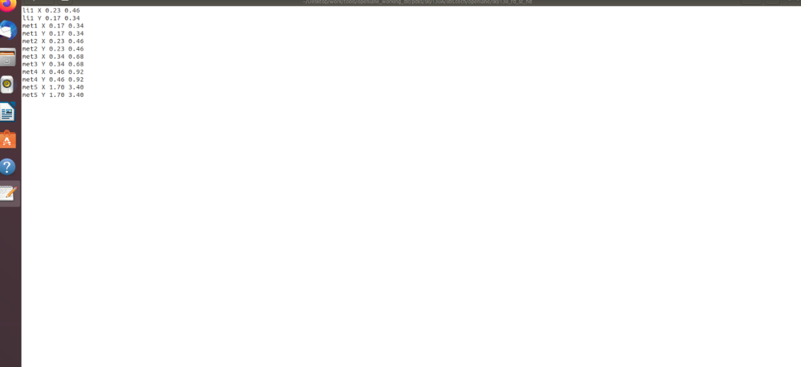
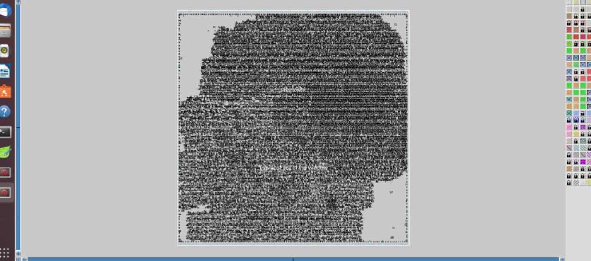
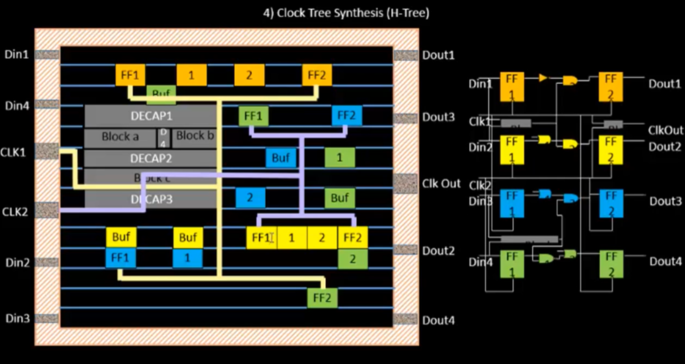
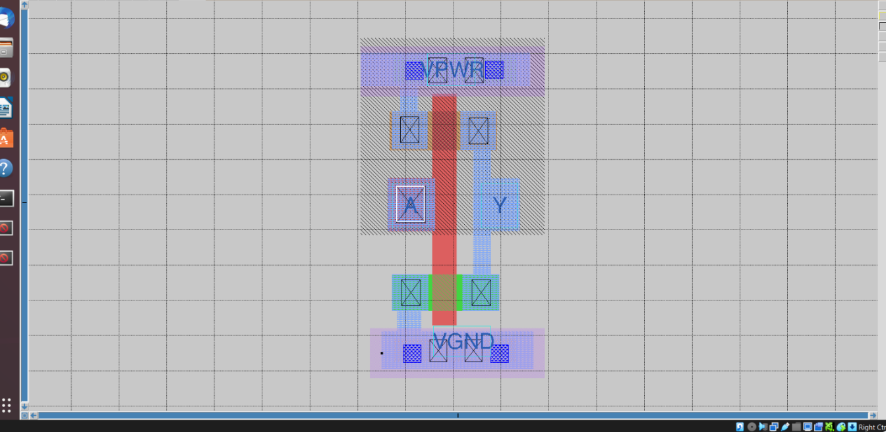
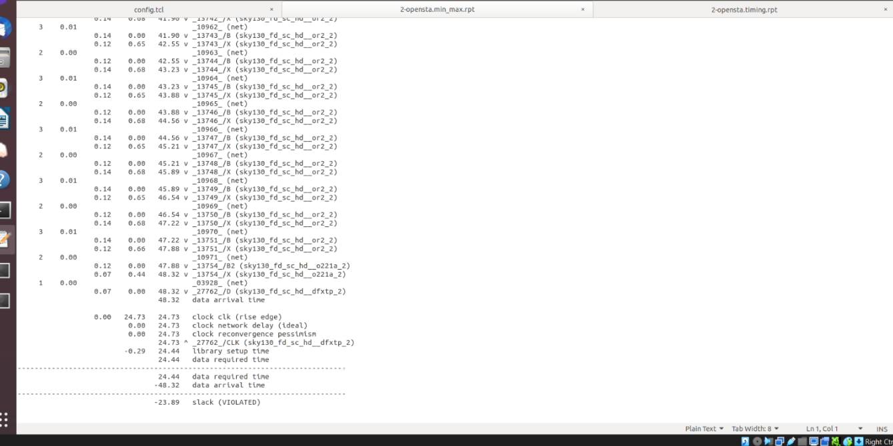
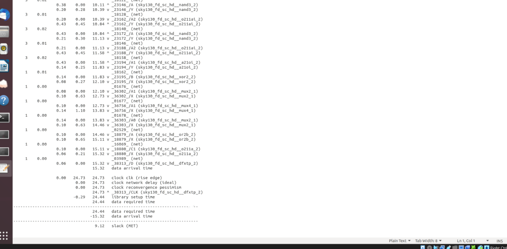

# OpenLane Physical Design and Static Timing Analysis Using SKY130A

## 1. Project Overview

This module documents practical work on ASIC physical design using the **OpenLane RTL-to-GDSII flow** and the **SkyWater SKY130A Process Design Kit (PDK)**.

The work focuses on understanding physical implementation outputs, routing-track information, standard-cell layout visualization, clock distribution concepts, and Static Timing Analysis (STA).

The screenshots included in this repository provide visual evidence of the examined outputs, including placement/layout views and timing reports containing both negative and positive slack.

The objective is to develop practical knowledge of ASIC implementation and understand how physical design decisions influence timing performance.

## 2. Objectives

- Understand the OpenLane RTL-to-GDSII implementation flow.
- Explore routing-track coordinates and physical routing resources.
- Examine standard-cell placement and layout visualization.
- Understand Clock Tree Synthesis (CTS) and H-tree clock distribution.
- Analyze setup timing reports using slack values.
- Understand the difference between timing violations and paths that meet timing.
- Learn how physical implementation and timing analysis contribute to ASIC design quality.

## 3. Tools and Technologies

| Tool / Technology | Purpose |
|---|---|
| OpenLane | Automated RTL-to-GDSII implementation flow |
| SKY130A PDK | Open-source CMOS technology platform |
| OpenSTA | Static timing analysis engine used in the flow |
| Magic / layout viewer | Physical layout inspection, where applicable |
| Tcl | Flow configuration and scripting |
| Ubuntu Linux | Development environment |

## 4. OpenLane Physical Design Flow

OpenLane integrates multiple tools to implement a digital design from RTL through physical design and layout generation.

The general flow includes:

1. RTL preparation and synthesis.
2. Floorplanning and initialization.
3. Standard-cell placement.
4. Clock Tree Synthesis.
5. Global and detailed routing.
6. Parasitic extraction and timing analysis.
7. Design-rule and physical verification.
8. Final GDSII generation.

The precise stages executed depend on the OpenLane version, configuration, and run progress. The screenshots in this repository document selected outputs rather than independently proving completion of every stage.

## 5. Module Outputs and Results

### 5.1 Routing Track Information

Routing tracks define the preferred routing locations and spacing used by the physical design tools. Track coordinates help establish the routing grid for interconnecting cells and other circuit elements.

**Screenshot:**



**Observations:**
- Examined routing-track coordinate information.
- Studied the relationship between routing grids and metal interconnects.
- Observed how technology-dependent routing resources are represented.

Track information describes available routing resources; it does not alone confirm successful completion of routing.

### 5.2 Standard-Cell Placement and Physical Layout

Placement determines where standard cells are positioned within the design area. Their physical locations influence wire length, congestion, parasitic effects, and timing.

**Screenshot:**



**Observations:**
- Inspected the physical layout representation.
- Examined the relationship between placement and interconnect formation.
- Studied the role of cell positioning in physical implementation.

A complete placement evaluation would additionally examine utilization, placement legality, congestion, and relevant reports.

### 5.3 Clock Tree Synthesis — H-Tree Concept

Clock Tree Synthesis distributes the clock signal to sequential elements, including flip-flops. A balanced H-tree structure aims to reduce differences in clock arrival times across the design.

**Screenshot:**



**Important concepts:**
- Clock latency and insertion delay.
- Clock skew between sequential elements.
- Clock buffering and fanout.
- Impact of clock distribution on setup and hold timing.

The image illustrates the H-tree distribution concept. Actual CTS completion and clock-quality metrics should be confirmed using the corresponding OpenLane run reports.

### 5.4 Standard-Cell Layout and Grid View

The layout view provides a closer look at the physical geometry of a standard cell, including visible shapes, contacts, and layer representations.

**Screenshot:**



**Observations:**
- Examined physical cell geometry and layer representation.
- Observed layout alignment with the underlying grid.
- Studied contacts and connections between physical layers.
- Related logical circuit elements to their physical implementation.

Physical correctness must be established using the appropriate design-rule and connectivity checks, rather than visual inspection alone.

### 5.5 Static Timing Analysis — Violated Path

**Reported slack: −23.89**

The timing report shows a path with negative slack. Negative slack means the data arrival time exceeds the required arrival time under the timing constraints used for that analysis.

**Screenshot:**



The basic relationship is:

`Slack = Required Arrival Time − Data Arrival Time`

A negative slack value indicates that the analyzed path does not satisfy its timing requirement.

**Possible contributing factors:**
- Excessive combinational logic depth.
- Large cell or interconnect delays.
- High fanout and capacitive loading.
- Tight clock-period constraints.
- Unfavorable timing relationships.

**Potential next steps:**
1. Inspect the critical path and identify delay contributions.
2. Verify clock definitions and timing constraints.
3. Review cell delays, fanout, and interconnect effects.
4. Apply suitable logic or physical optimization.
5. Rerun timing analysis to evaluate the result.

The reported value is taken from the screenshot. Confirm the original report's units and analysis conditions before making quantitative comparisons.

### 5.6 Static Timing Analysis — Path Meeting Timing

**Reported slack: +9.12**

The second timing report shows positive slack. This indicates that the analyzed path meets its timing requirement under the constraints used to generate that report.

**Screenshot:**



**Observations:**
- The analyzed path has positive timing margin.
- Data arrival time is earlier than the required arrival time.
- Slack can be used to assess the timing margin of an individual path.
- Different paths within the same design may have different timing outcomes.

A positive slack value for one path does not establish that the entire design is timing-clean. Complete timing closure requires checking all relevant setup and hold paths and verifying the applicable constraints.

## 6. Timing Results Summary

| Parameter | Violated Path | Met Path |
|---|---:|---:|
| Reported slack | −23.89 | +9.12 |
| Status | VIOLATED | MET |
| Interpretation | Timing requirement not met | Timing requirement met |
| Recommended action | Investigate and optimize | Check remaining paths |

*The values are transcribed from the provided screenshots. Verify their units and analysis conditions in the original OpenSTA reports.*

## 7. Key Learnings

Through this module, the following concepts were explored:

- OpenLane-based ASIC physical implementation.
- Routing tracks and physical routing resources.
- Standard-cell placement and layout visualization.
- Clock distribution and H-tree concepts.
- Reading timing reports and interpreting slack.
- Identifying timing violations and paths that meet constraints.
- Understanding the importance of timing constraints and critical-path analysis.
- Recognizing the need for comprehensive physical and timing verification.

## 8. Repository Structure

```text
openlane-physical-design-sta/
├── README.md
└── images/
    ├── tracks.png
    ├── placement.png
    ├── htree.png
    ├── grid.png
    ├── slackviolated.png
    └── slackreduced.png
```

## 9. Future Improvements

The module can be extended with additional OpenLane implementation evidence:

- Synthesis statistics and cell counts.
- Floorplan and placement reports.
- CTS reports, clock skew, and insertion delay.
- Global and detailed routing reports.
- Setup and hold timing summaries.
- Worst Negative Slack (WNS) and Total Negative Slack (TNS).
- Design-rule-check results.
- Power, performance, and area (PPA) reports.
- Final GDSII generation and verification evidence.

These additions would help establish implementation completeness and provide a more comprehensive view of ASIC design quality.

## 10. Conclusion

This module documents practical exploration of ASIC physical design outputs using OpenLane and the SKY130A technology platform.

The screenshots illustrate routing-track information, placement and layout visualization, clock distribution concepts, and timing reports with both negative and positive slack.

The timing results demonstrate the importance of evaluating individual paths and investigating violations before declaring timing closure. Further verification using the complete OpenLane run reports is necessary to establish the overall implementation status.

**Tools:** OpenLane | OpenSTA | SKY130A | Tcl | Ubuntu Linux

**Focus Areas:** ASIC Physical Design | Placement | Clock Tree Synthesis | Routing | Static Timing Analysis
