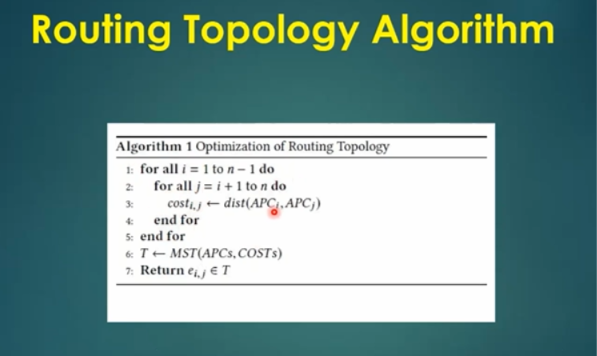
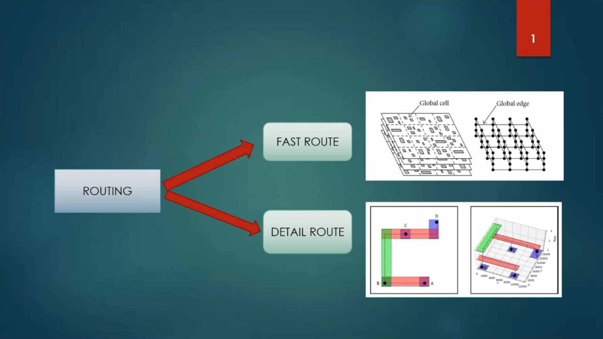
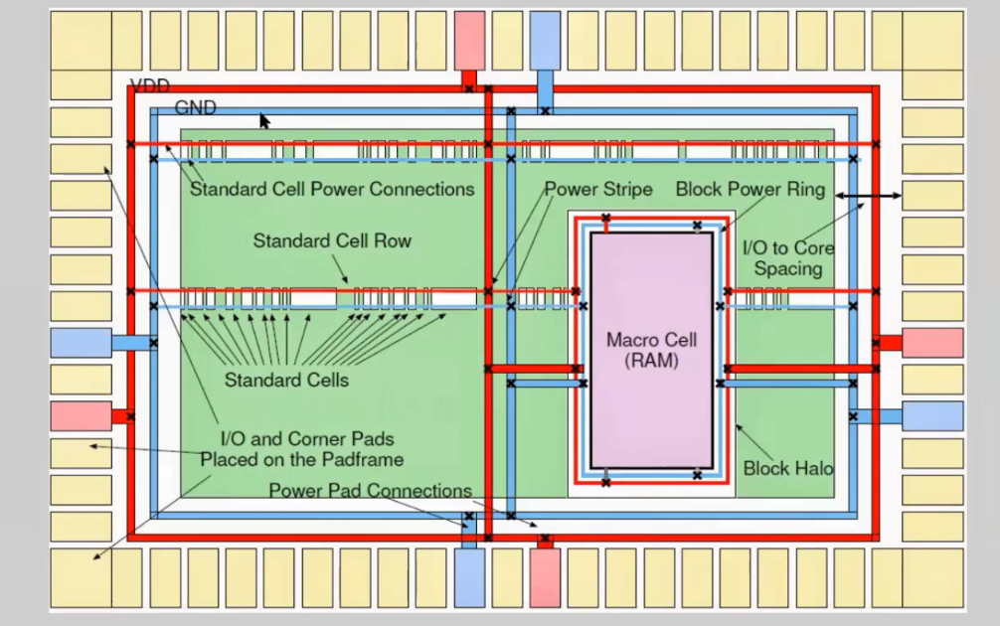
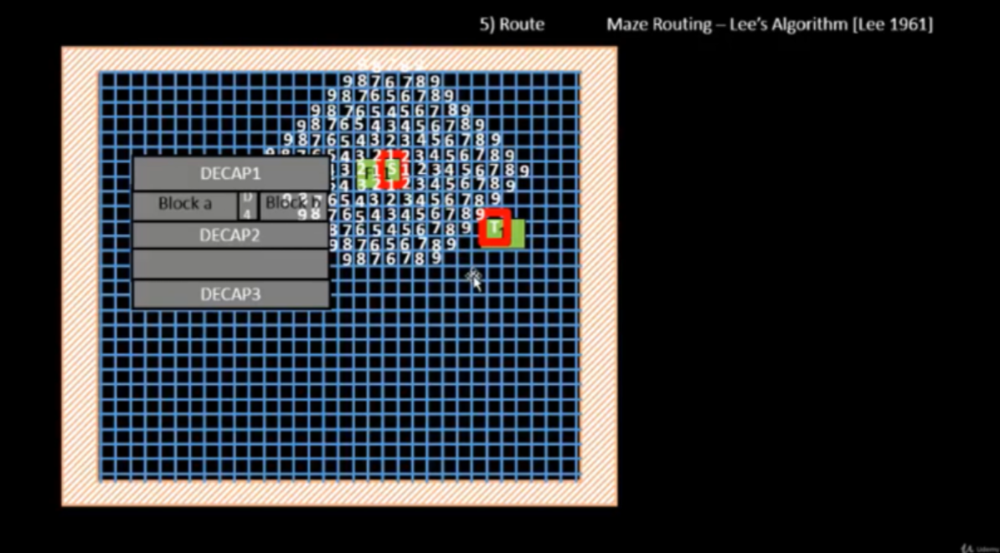

# ASIC Routing and Physical Verification Using OpenLane and SKY130A

## 1. Project Overview

This module explores routing and physical-verification concepts used in ASIC implementation with the **OpenLane RTL-to-GDSII flow** and the **SkyWater SKY130A Process Design Kit (PDK)**.

Routing creates the physical interconnections between standard cells, macros, clock networks, and I/O pins using available metal layers. Physical verification then checks whether the resulting layout follows the applicable design rules and has the expected connectivity.

The images below document routing topology, global and detailed routing concepts, power-distribution structures, and maze routing.

## 2. Objectives

- Understand the role of routing in the ASIC physical-design flow.
- Learn the difference between global routing and detailed routing.
- Explore routing topology optimization and minimum-spanning-tree concepts.
- Understand routing grids, routing resources, and congestion.
- Identify power rings, power stripes, standard-cell rows, and macro regions.
- Learn the basic operation of Lee's maze-routing algorithm.
- Understand the purpose of DRC, LVS, connectivity, antenna, and timing checks.

## 3. Tools and Technologies

| Tool / Technology | Purpose |
|---|---|
| OpenLane | Automated RTL-to-GDSII implementation flow |
| SKY130A PDK | Open-source CMOS technology platform |
| TritonRoute | Detailed-routing engine in applicable flow configurations |
| OpenSTA | Static timing analysis |
| Magic | Layout inspection and physical verification, where configured |
| Tcl | Flow configuration and scripting |
| Ubuntu Linux | Development environment |

The exact tools and stages depend on the OpenLane version and configuration used for the design.

## 4. Routing in the ASIC Physical-Design Flow

A typical routing and verification sequence includes:

1. **Routing preparation:** Load the placed design, technology information, routing layers, and constraints.
2. **Global routing:** Plan approximate routes and allocate routing resources.
3. **Detailed routing:** Create physical wire segments and vias while observing routing rules.
4. **Routing optimization:** Address congestion, design-rule issues, and interconnect-related timing problems.
5. **Parasitic extraction:** Estimate or extract interconnect resistance and capacitance.
6. **Post-route timing analysis:** Evaluate timing with implemented interconnect information.
7. **Physical verification:** Run applicable design-rule and connectivity checks.

Routing completion alone does not prove that every physical-verification check has passed.

## 5. Routing Topology Optimization



Routing topology optimization determines how a net should connect its source and destination terminals while considering connection cost and physical distance.

A routing algorithm may represent candidate connections as a weighted graph. A minimum spanning tree (MST) is one possible method for connecting multiple terminals while minimizing the total edge cost.

A simplified process is:

1. Identify the connection points.
2. Calculate candidate connection costs or distances.
3. Represent possible connections as a weighted graph.
4. Construct a tree connecting the required terminals.
5. Use the topology as a basis for routing.

**Key point:** A short geometric route does not always produce the best timing or congestion result. Practical routing must also consider design rules, routing-layer availability, congestion, and electrical constraints.

*The image illustrates the routing-topology concept; it is not, by itself, proof of the topology generated by a particular OpenLane run.*

## 6. Global Routing and Detailed Routing



Routing is commonly divided into two stages.

### 6.1 Global Routing

Global routing determines approximate paths through the design and allocates routing resources. It helps identify congested regions and provides guidance for detailed routing.

Typical goals include:

- Selecting approximate routing paths.
- Allocating routing resources.
- Estimating routing demand.
- Identifying congestion.

### 6.2 Detailed Routing

Detailed routing turns approximate paths into actual wire geometries and vias on available routing layers.

Typical responsibilities include:

- Connecting the required terminals.
- Selecting valid metal layers and tracks.
- Creating wire segments and vias.
- Respecting spacing, enclosure, and other routing rules.
- Resolving routing conflicts.

TritonRoute is a detailed-routing engine used in applicable OpenLane configurations.

**Key point:** Global routing plans where connections should travel; detailed routing determines how those connections are physically implemented.

*Confirm successful routing completion using the actual OpenLane logs and reports.*

## 7. Power Distribution and Floorplan Structures



The floorplan illustration identifies structures commonly used in ASIC physical design, including standard-cell rows, a macro region, power rings, power stripes, and I/O pads.

### Power Rings

Power rings are conductive structures around a core or macro region that distribute power and ground.

### Power Stripes

Power stripes carry power and ground across the design and connect with other parts of the power-distribution network (PDN).

### Standard-Cell Rows

Standard-cell rows define legal placement regions for standard cells and help organize the physical implementation.

### Macro Cells and Blockages

Large blocks, such as SRAM macros, occupy designated regions. Their placement and blockages affect the routing resources available nearby.

### Input/Output Pads

I/O pads provide connections between the internal circuit and external signals or power connections, depending on the design architecture.

**Key point:** Routing must account for signal interconnections as well as power delivery, macros, and I/O requirements.

*This is a conceptual floorplan illustration. Do not treat it as the actual floorplan or verified PDN of your design unless it came from your own implementation run.*

## 8. Maze Routing Using Lee's Algorithm



Lee's algorithm is a classic grid-based maze-routing algorithm. It searches for a path from a source to a destination while avoiding blocked grid locations.

### Working Principle

1. **Initialize the grid:** Mark available locations and obstacles.
2. **Set the source:** Identify the starting point.
3. **Propagate the search:** Explore neighboring cells and assign increasing distance labels.
4. **Reach the destination:** Continue until the destination is reached or no valid path remains.
5. **Backtrace:** Reconstruct a path from the destination to the source.
6. **Generate the route:** Convert the grid path into a sequence of routing segments.

### Advantages

- Systematic path exploration.
- Finds a shortest path in an unweighted grid when a path exists.
- Can avoid obstacles represented in the grid.
- Useful for understanding grid-based routing.

### Limitations

- Can require substantial memory and computation on large grids.
- A shortest grid path does not necessarily minimize real interconnect delay.
- Practical detailed routing must also consider metal layers, vias, congestion, design rules, and electrical constraints.

**Key point:** Lee's algorithm is useful for understanding maze routing, while production routing tools use more advanced methods and additional optimization objectives.

## 9. Final Physical Verification

Physical verification evaluates whether the implemented layout satisfies the applicable geometric and electrical requirements.

### 9.1 Design Rule Checking (DRC)

DRC checks layout geometry against technology rules, such as minimum metal width, spacing, and via enclosure.

### 9.2 Layout Versus Schematic (LVS)

LVS compares the circuit extracted from the physical layout with the intended netlist. It helps identify missing connections, unintended shorts, and structural mismatches.

### 9.3 Connectivity and Antenna Checks

Connectivity checks look for opens or shorts. Antenna checks identify potential fabrication-related risks caused by charge accumulation on connected structures.

### 9.4 Timing Verification

Post-route timing analysis evaluates the impact of interconnect delays on setup and hold requirements. Relevant reports may include:

- Setup and hold timing summaries.
- Worst Negative Slack (WNS).
- Total Negative Slack (TNS).
- Parasitic extraction results.

### 9.5 Final GDSII Generation

GDSII is a layout database format used to represent the physical geometry of an integrated circuit. Confirm successful generation and all required verification checks from the actual flow logs before describing the design as fully verified.

**Important:** The screenshots in this repository illustrate routing and physical-design concepts. Actual DRC, LVS, antenna, timing, routing, and GDSII completion status must be supported by reports from your own OpenLane run.

## 10. Key Learnings

- Routing topology and connection-cost concepts.
- The difference between global and detailed routing.
- Routing-resource allocation and congestion.
- Power rings, power stripes, and floorplan structures.
- Standard-cell rows and macro placement considerations.
- Grid-based maze routing using Lee's algorithm.
- Physical verification using DRC and LVS.
- The importance of post-route timing analysis.
- The distinction between routing completion and final verification.

## 11. Repository Structure

```text
openlane-routing-verification/
├── README.md
└── images/
    ├── topo.png
    ├── tritonroute.png
    ├── macram.png
    └── leealgooo.png
```

## 12. Suggested Future Improvements

To document the actual implementation more completely, add:

- Global-routing and detailed-routing completion logs.
- Congestion reports.
- DRC violation counts and reports.
- LVS and connectivity results.
- Antenna-check results.
- Post-route timing reports.
- Extracted parasitic information.
- Final GDSII generation logs.

## 13. Conclusion

This module documents routing algorithms and physical-verification concepts relevant to ASIC implementation using OpenLane and SKY130A.

The topology diagram introduces connection optimization; the routing diagram distinguishes global routing from detailed routing; the floorplan diagram explains power-distribution and macro structures; and the Lee's algorithm diagram illustrates grid-based pathfinding around obstacles.

These topics provide a foundation for understanding ASIC routing and verification. The actual implementation status must be confirmed using the corresponding OpenLane logs and physical-verification reports.

**Tools:** OpenLane | SKY130A | TritonRoute | OpenSTA | Magic | Tcl | Ubuntu Linux

**Focus Areas:** ASIC Routing | Global Routing | Detailed Routing | Routing Topology | Power Distribution | Maze Routing | Physical Verification

