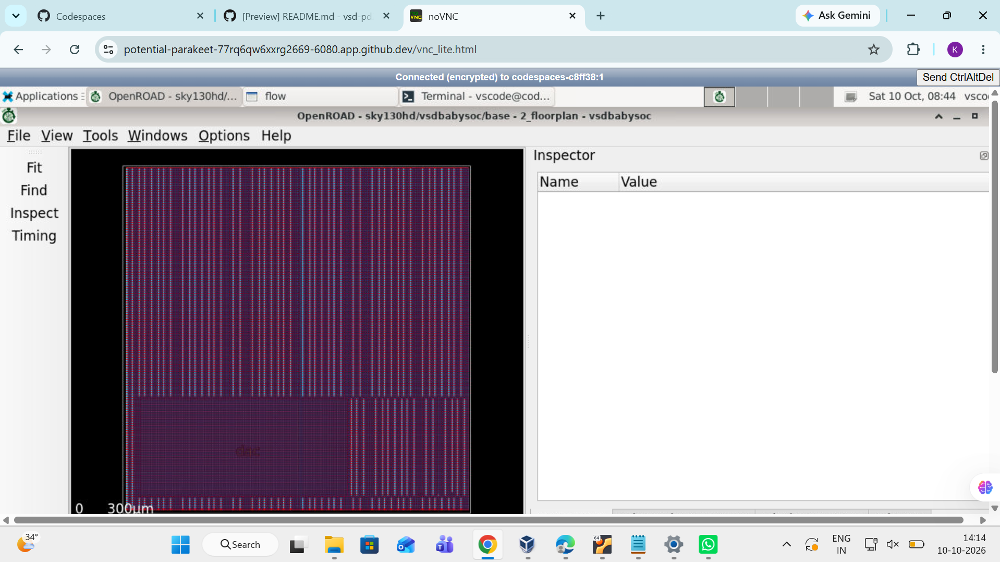
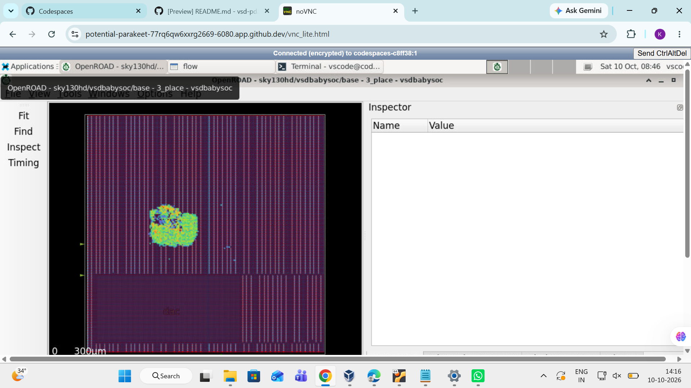
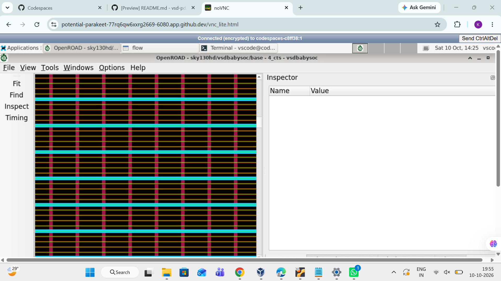
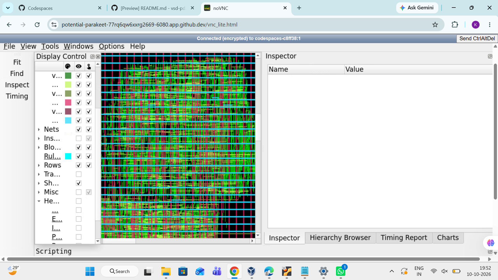

# OpenROAD Physical Design Implementation of vsdbabysoc Using Sky130HD

## 1. Project Overview

This project focuses on the physical design implementation of the **vsdbabysoc** design using the OpenROAD physical design tool and the Sky130HD open-source standard-cell platform.

The objective is to understand how a digital design progresses from an initial floorplan to a physically implemented layout through placement, Clock Tree Synthesis (CTS), and routing.

The project also provides practical experience with physical design databases, layout visualization, standard-cell placement, routing layers, and the overall ASIC implementation flow.

## 2. Project Objectives

- Understand the ASIC physical design flow using OpenROAD.
- Inspect the floorplan and core layout of the design.
- Understand standard-cell placement and physical organization.
- Examine the layout after Clock Tree Synthesis.
- Visualize routed signal interconnections and metal layers.
- Understand the role of each physical design stage in preparing a design for manufacturing.
- Gain hands-on experience with open-source EDA tools and the Sky130HD technology platform.

## 3. Tools and Technologies

| Component | Description |
|---|---|
| Physical Design Tool | OpenROAD |
| Implementation Flow | OpenROAD-flow-scripts |
| Technology Platform | Sky130HD |
| Design Under Implementation | vsdbabysoc |
| Operating Environment | Linux |
| Development Environment | GitHub Codespaces |
| Layout Visualization | OpenROAD GUI |
| Design Data | Physical design databases and generated flow outputs |

## 4. ASIC Physical Design Flow

The physical implementation stages examined in this project are:

1. Floorplanning
2. Placement
3. Clock Tree Synthesis (CTS)
4. Routing

Each stage builds upon the output of the preceding stage. The exact outputs and completion status depend on the configured flow and successful execution of the corresponding stage.

## 5. Implementation Details

### 5.1 Floorplanning

Floorplanning establishes the initial physical organization of the design.

**Work performed:**

- Opened the floorplan-stage design in the OpenROAD GUI.
- Inspected the core boundary and standard-cell rows.
- Examined the physical dimensions and overall layout organization.
- Observed the initial arrangement of the design before placement optimization.

**Purpose:**

The floorplan defines the physical region in which the design is implemented. It influences placement density, routing resources, power distribution, and overall implementation quality.

**Observation:**

The floorplan-stage layout was opened and visually inspected to understand the physical structure of the design.

### 5.2 Placement

Placement determines the physical locations of standard-cell instances within the floorplan.

**Work performed:**

- Opened the placement-stage database.
- Inspected the distribution of standard cells across the placement region.
- Examined the placement layout and cell organization.
- Observed the physical arrangement of instances within the available core area.

**Purpose:**

Placement attempts to organize cells while considering timing, congestion, wirelength, and design constraints. Good placement helps prepare the design for clock-tree synthesis and routing.

**Observation:**

The placement-stage layout was examined using the OpenROAD GUI to understand the distribution of instances and the structure of the placed design.

### 5.3 Clock Tree Synthesis (CTS)

Clock Tree Synthesis builds a clock distribution network to deliver the clock signal to sequential elements.

**Work performed:**

- Opened the CTS-stage design in the OpenROAD GUI.
- Inspected the physical layout after clock-tree synthesis.
- Examined the design structure and clock-related physical implementation.
- Compared the CTS-stage view with the earlier physical design stages.

**Purpose:**

CTS manages clock distribution and aims to control clock skew and clock latency. The resulting network must satisfy the design's clock constraints while considering buffering and routing requirements.

**Observation:**

The CTS-stage database was opened and its physical layout was visually inspected.

### 5.4 Routing

Routing connects the placed standard cells using the available interconnect layers.

**Work performed:**

- Opened the routed design in the OpenROAD GUI.
- Inspected the routed physical layout.
- Examined visible metal layers and via structures.
- Observed the interconnections between cells across the design region.

**Purpose:**

Routing establishes the electrical connections required by the design netlist. It uses available metal layers and vias while considering design rules, connectivity, and routing constraints.

**Observation:**

The routed design was inspected in the OpenROAD GUI, providing a visual understanding of the interconnect structure and metal routing across the layout.

## 6. Physical Design Concepts Learned

### Floorplanning
- Core area and physical boundaries
- Standard-cell rows
- Initial physical organization

### Placement
- Standard-cell instance distribution
- Placement density
- Physical organization of the design

### Clock Tree Synthesis
- Clock distribution networks
- Clock buffers and clock-tree implementation
- Clock skew and latency concepts

### Routing
- Metal interconnect layers
- Vias and layer connections
- Signal connectivity
- Physical routing structure

## 7. Repository Structure

Organize the project files as follows:

```text
vsdbabysoc/
├── README.md
└── screenshots/
    ├── floorplan.png
    ├── placement.png
    ├── cts.png
    └── routing.png
```

The screenshot filenames above are suggested names. Use the actual filenames you upload to GitHub, and update the Markdown image paths accordingly.

## 8. Implementation Snapshots

### Floorplan View



The floorplan view illustrates the initial physical organization of the design.

### Placement View



The placement view illustrates the physical arrangement of standard-cell instances.

### Clock Tree Synthesis View



The CTS view illustrates the design layout after clock-tree synthesis.

### Routing View



The routing view illustrates the routed design and its visible metal interconnections.

## 9. Results and Observations

During this work, the following activities were performed:

- Inspected the floorplan-stage layout of vsdbabysoc.
- Examined the placement-stage physical organization.
- Viewed the design after Clock Tree Synthesis.
- Inspected the routed design and its metal interconnections.
- Used the OpenROAD GUI to explore physical design databases.
- Gained practical exposure to the ASIC physical implementation flow using Sky130HD.

These observations describe the captured GUI views. Successful completion of each implementation stage should be verified using its run logs and generated output files.

## 10. Future Scope

- Verify the completion status of all physical design stages.
- Organize generated databases, reports, and logs.
- Review routing and design-rule-check results where available.
- Study the final layout and verify that the required implementation outputs are generated.
- Document additional physical design metrics when validated reports become available.

## 11. Conclusion

This project provides practical exposure to the physical implementation of the vsdbabysoc design using OpenROAD and the Sky130HD platform.

By examining floorplanning, placement, Clock Tree Synthesis, and routing, the work helps build an understanding of how a digital design is organized and interconnected during ASIC physical design.

The project serves as a foundation for further exploration of physical design optimization, implementation verification, and final layout generation.

## 13. References

- [OpenROAD Project](https://github.com/The-OpenROAD-Project/OpenROAD)
- [OpenROAD-flow-scripts](https://github.com/The-OpenROAD-Project/OpenROAD-flow-scripts)
- [SkyWater SKY130 PDK](https://github.com/google/skywater-pdk)


